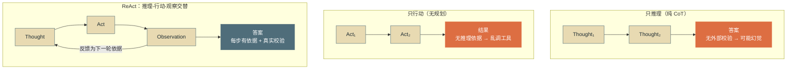
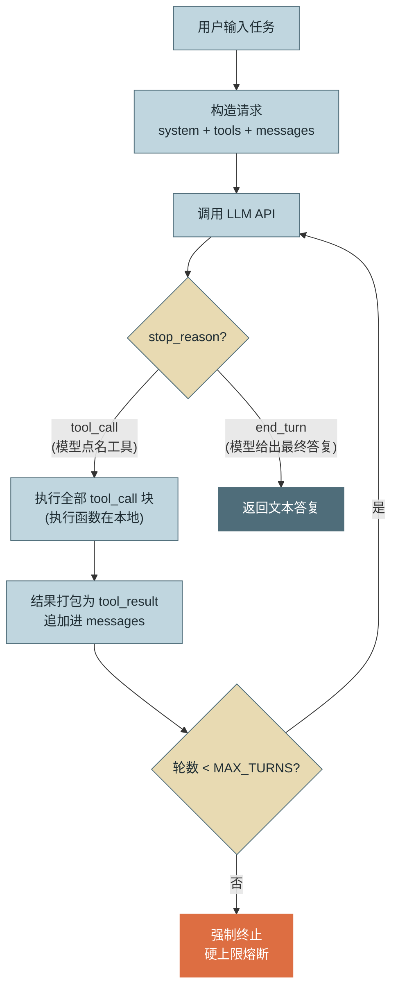
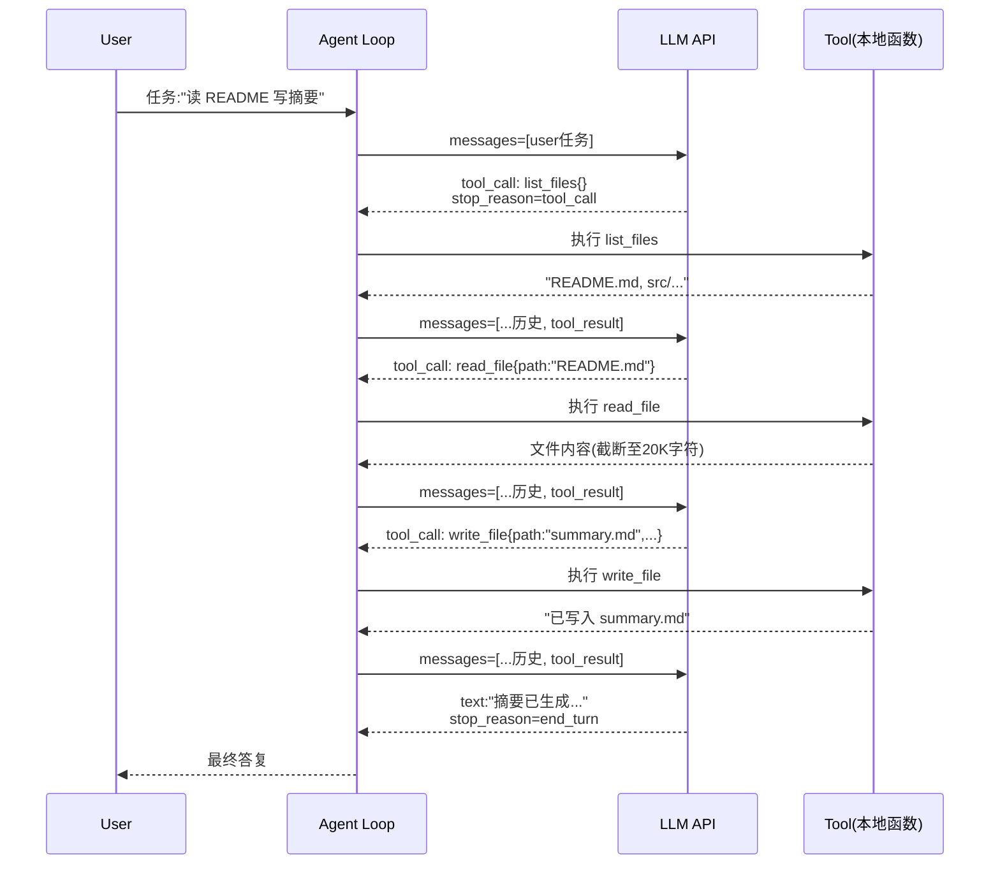

# 1. 场景引入
> 不使用任何Agent框架，是否可以用任何语言实现一个能完成多步任务的Agent？
> 即剥离框架后，**Agent的最小可运行形态到底有几行？里面每一行都在做什么？**


本章节重点不是编码，而是**心智模型**：理解Agent的本质只是*“一个调用 `LLM API` 的 `while` 循环，循环体里执行模型点名的工具”*。
任何框架都只是这个循环的封装变体。

# 2. 原理
## 2.1 ReAct：推理与行动的交替
**ReAct**（Reasoning + Acting）核心思想**让模型交替产生推理轨迹（Thought）和行动（Action），行动的观察结果（Observation）再反馈给下一轮推理**。
相比只推理（纯CoT，容易幻觉出不存在的事实）和“只行动（无规划，容易乱调工具）”，交替结构让每一步行动都有推理依据、每一步推理都有真实观察支撑。

早期**ReAct**靠提示词约定（`Thought:/Action:/Observation`）文本格式，再用正则解析——脆弱且被格式错误打乱。2023年中之后，**原生工具调用（Tool Use Api）** 把“行动”变成了结构化协议：模型输出带 JSON Schema 校验的 `tool_call` 内容块，运行时执行后以 `tool_result` 块回填。
## 2.2 最小循环的四个组成部分
剥到最小，一个可运行的Agent只需要四部分：
- **系统提示构造（System Prompt）**：定义Agent的身份、工作方式与约束。它决定模型“如何用工具”，是行为的第一控制面。
- **工具注册（Tool Registry）**：每个工具 = 名称 + 描述 + 参数Schema + 本地执行函数。前三者随请求发送给模型（模型只看得到“说明说”），执行函数留在本地（模型永远碰不到代码）。
- **循环驱动（Loop Driver）**：调用LLM→检查响应→执行工具→回填结果→再调用。**对话历史（messages数组）就是循环的全部状态）——这一点是理解一切Agent运行时的钥匙**。
- **终止判断（Termination）**：模型侧信号（`stop_reason`不再是`tool_calls`，说明模型认为无需继续行动）。

## 2.3 消息协议：一次三轮任务的完整时序
循环的每一“轮”再网络上是一次完整的 *HTTP请求/响应*，**API本身无状态** ——历史由客户端（即我们的循环）随每次请求全量重发。以“查文件→读内容→写报告”任务为例，完整消息时序如下：

# 3. 手动实现
## 3.1 单文件最小Agent
**工具注册**：即让模型知道能“它够做些什么”。
每个工具是一个自包含对象：`name\description\`
```python
# 1. 定义工具  
def list_files(inp: dict) -> list[Path]:  
    """列出指定目录下的文件，默认为当前目录"""  
    return "\n".join(sorted(p.name for p in Path(inp.get("dir", ".")).iterdir()))  
  
  
def read_file(inp: dict) -> str:  
    """读取指定路径的文件，截取200字符，避免超长"""  
    return Path(inp["path"]).read_text(encoding="utf-8")[:20_000]  
  
  
def write_file(inp: dict) -> str:  
    """将指定content写入到目标路径文件中，覆盖写入"""  
    Path(inp["path"]).write_text(inp["content"], encoding="utf-8")  
    return f"文件已写入 {inp['path']} ({len(inp['content'])} 字符)"  
  
  
# 2. 将工具注册为DeepSeek规范的工具列表  
TOOLS = [  
    {  
        "name": "list_files",  
        "description": "列出指定目录下的文件，默认为当前目录",  
        "parameters": {  
            "type": "object",  
            "properties": {"path": {"type": "string", "description": "需要列出文件的目录"}},  
            "required": []  
        },  
        "run": list_files,  
    },  
    {  
        "name": "read_file",  
        "description": "读取指定路径的文件，截取200字符，避免超长",  
        "parameters":  
            {  
                "type": "object",  
                "properties": {"path": {"type": "string", "description": "需要读取的文件路径"}},  
                "required": ["path"]  
            },  
        "run": read_file,  
    },  
    {  
        "name": "write_file",  
        "description": "将指定content写入到目标路径文件中，覆盖写入",  
        "parameters":  
            {  
                "type": "object",  
                "properties": {"path": {"type": "string", "description": "需要写入的文件路径"},  
                               "content": {"type": "string", "description": "需要写入的上下文"}},  
                "required": ["path", "content"]  
            },  
        "required": [],  
        "run": write_file,  
    },  
]  
  
TOOL_BY_NAME: dict[str, Any] = {t["name"]: t for t in TOOLS}
```
**系统提示构造**：这段解决的问题是"给 Agent 定人设与边界"。哪怕最小实现，也要包含身份、工作方式、约束三层。
```python
SYSTEM_PROMPT = """  
你是示例助手，一个企业内部任务执行Agent。  
工作方式：先思考需要哪些信息，再调用工具获取，信息足够后完成任务，直接给出最终答复。  
约束：只操作当前工作目录；文件不存在或读取失败时如实报告，绝不编造内容。  
"""
```
**LLM调用**：把循环状态变成一次次无状态HTTP请求。
```python
# 3. 实现大模型调用  
def call_llm(messages: list[dict[str, Any]]) -> dict[str, Any]:  
    headers = {  
        "Authorization": f"Bearer {API_KEY}",  
        "Content-Type": "application/json"  
    }  
  
    payload = {  
        "model": "deepseek-chat",  
        "messages": messages,  
        "tools": tools,  
        "stream": False,  
        "temperature": 0.7,  
        "max_tokens": 1024  
    }  
  
    reply = requests.post(url=url, headers=headers, json=payload, timeout=30)  
    return reply.json()
```
**Agent循环驱动**：这是全文件的心脏。三个细节值得逐字读：① assistant 的**完整 content 数组**（含 `tool_call` 块）必须原样放回历史，只放文本会破坏 `id` 配对；② 工具**执行失败也要回填**，让模型看到错误自行纠错，而不是让进程崩溃——这就是最小形态的**反思（Reflection）**；③ 一轮的多个 `tool_result` 打包进**同一条** user 消息。
```python
# 4. Agent循环
def run_agent(task: str) -> str:  
    # 构建deepseek请求  
    messages = [  
        {"role": "system", "content": SYSTEM_PROMPT},  
        {"role": "user", "content": task}  
    ]  
  
    while (True):  
        reply = call_llm(messages)  
        choice = reply["choices"][0]  
        message = choice["message"]  
  
        messages.append(message)  # 将LLM的回复信息加入到历史列表中  
  
        if message.get("content"):  
            print(f"\n[思考] {message.get('content').strip()}")  
  
        # 判断大模型是否认为结束  
        if choice["finish_reason"] != "tool_calls":  
            return message["content"].strip()  
  
        # 进行工具调用  
        for t in message["tool_calls"]:  
            name = t["function"]["name"]  
            args = json.loads(t["function"]["arguments"])  
            print(f"\n[行动] 调用工具{name}({args})")  
  
            # 调用工具  
            try:  
                result = TOOL_BY_NAME[name]["run"](args)  
            except Exception as e:  
                result = f"工具调用出错{e}"  
            print(f"\n[观察] 调用结果{result}")  
  
            messages.append(  
                {"role": "tool", "tool_call_id": t["id"], "content": result}  
            )
```